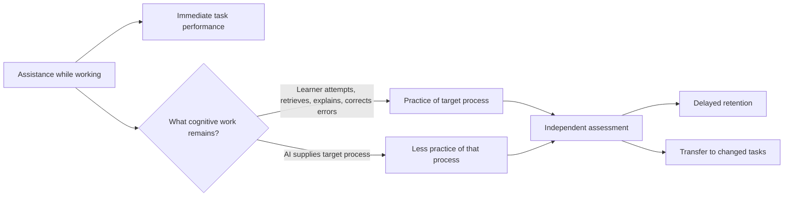

# When AI Helps You Finish but Not Learn: What Makes Assistance Transfer

## Editorial brief

**Recommended video title:** **When AI Helps You Finish but Not Learn: What Makes Assistance Transfer**

**Accurate alternative titles:** **Why an AI Answer Can Make You Faster Without Making You Better**; **AI as Tutor or Crutch: What Actually Helps You Learn**

**Central question:** Under what conditions does AI assistance help a person acquire knowledge or skill they can later use without the AI, rather than merely helping them finish the current task?

**Evidence-based one-sentence answer:** AI assistance can improve learning when it preserves meaningful learner activity—such as responding to questions, correcting mistakes, retrieving knowledge, or working through structured hints—but assistance that substitutes for those activities can produce excellent assisted performance without equivalent independent learning; the effect depends strongly on learner expertise, task type, assistance design, and what the later test measures. [C01–C11; S01–S11] citeturn2search1turn18view1turn19search0turn25search0

**Why viewers would care:** A user can watch an AI produce a correct solution and feel that the solution is understandable, yet that feeling does not establish that the user can reproduce the reasoning later or adapt it to a changed problem. Conversely, withholding every answer is not an evidence-based rule either: well-designed worked examples can outperform unguided problem solving for novices. The useful distinction is therefore not “AI versus no AI,” but **which cognitive work the tool does for you, which work it leaves to you, and what you can do when the tool disappears**. [C01, C09] citeturn23view0turn20search0

**Scope and bounded promise:** The report focuses on short- and medium-horizon learning evidence from mathematics, physics, memory research, and experimental AI tutoring. Geographic scope was not specified in the brief; included evidence spans Turkey, the United States, online adult samples, and multi-country educational literature. The studies do **not** justify a universal claim about all adults, all subjects, or all AI systems. In particular, the strongest “AI as a crutch” field result is a high-school mathematics experiment, whereas other experiments show substantial learning gains from more structured AI tutors. citeturn2search1turn18view1

**Evidence method:** The assignment’s proposed title, opening scenario, and illustrations were treated as editorial hypotheses rather than facts. fileciteturn0file0 The starting PNAS study and UCLA Bjork Lab material were rechecked; the PNAS publication has a later correction, but the correction concerns production/affiliation information rather than the reported experimental result. Primary randomized experiments, peer-reviewed reviews/meta-analyses, and original working papers were prioritized; a very recent Socratic-tutoring preprint is retained only as low-strength counterevidence. citeturn2search1turn2search2turn18view9

**Executive finding:** The original title, *Why AI Can Explain It, but You Still Can't Do It*, is too categorical. Sometimes an explanation or worked example **does** improve later performance, especially for novices. A more defensible story is that **current-task success, learning, retention, and transfer are separate outcomes, and an AI interface can move them in different directions**. citeturn20search0turn20search3

## Verified explanatory material

The first distinction is measurement. **Immediate task performance** means how well someone performs while assistance is available: for example, whether the homework problem is answered correctly with an AI chat window open. **Independent performance** asks what happens after the support is removed. **Retention** adds a time interval: can the learner still retrieve and use the knowledge later? **Transfer** raises the bar again by changing the problem so that simply reproducing the practiced response is insufficient. A study that measures only an immediate post-test cannot establish durable retention, and a test containing similar questions provides weaker evidence of transferable skill than a genuinely new task. Research on learning and memory has long warned that smooth performance during practice can diverge from later learning. [C01; S06] citeturn23view0turn23view3

The clearest AI example of that dissociation is Bastani and colleagues' randomized field experiment with nearly 1,000 high-school mathematics students in Turkey. During practice, a GPT-4-based general chat interface, “GPT Base,” raised practice grades by 48% relative to the control condition, while a safeguarded “GPT Tutor,” designed around teacher-provided solutions and hints rather than simply revealing answers, raised practice grades by 127%. But when students subsequently took an exam without AI or other resources, the GPT Base group scored 17% below the control group. For GPT Tutor, that negative effect was essentially eliminated, yet the tutor did **not** produce a statistically significant positive exam gain over control. Interaction logs indicated substantially more solution requesting and copying with GPT Base and more help-seeking or independent attempts with GPT Tutor. [C02, C03; S01] citeturn2search1turn20search3

That experiment therefore measures two different things: AI-assisted problem completion and subsequent unassisted performance. It should **not** be described as evidence of long-term forgetting or permanent deskilling—the unassisted exam was a short-term learning measure, not a months-later test. Nor was GPT Base a laboratory condition forcing students to read complete answers: it was an unrestricted tool that *allowed* answer-seeking, and students chose different interaction strategies. [C02, C03; S01] citeturn2search1

Other AI experiments show why the conclusion cannot be “AI explanations prevent learning.” Kestin and colleagues randomized students in Harvard's introductory Physical Sciences 2 course in a crossover trial comparing active classroom instruction with an expert-designed AI tutor. The AI system used structured sequencing, content-specific prompts, prewritten expert solutions to improve accuracy, interactive questions, feedback, and self-pacing. Median post-test scores were 4.5 for the AI condition versus 3.5 for classroom active learning; the regression estimate corresponded to 0.63 standard deviations, with a ceiling-adjusted estimate of 0.73–1.3 SD. Median AI time on task was 49 minutes, versus 60 minutes allocated to classroom learning. Crucially, however, the post-test was immediate. This is strong evidence that a tightly engineered AI tutor can teach particular physics material efficiently, not evidence about months-later retention. [C04; S02] citeturn18view1

Pardos and Bhandari provide another useful comparison. In a randomized 3-by-4 study with 274 participants across algebra and statistics topics, students received no help, human tutor-authored hints, or ChatGPT-generated help. The ChatGPT condition showed a 17% learning gain versus 1.85% for the no-help control; differences between ChatGPT and human tutor help were not statistically distinguishable. Yet 32% of the initially generated ChatGPT hints failed the researchers' quality checks for incorrect work and answer, emphasizing that pedagogical format is irrelevant if the content itself is unreliable. Their intervention was a generated worked-solution hint, not a clean test of free-form Socratic dialogue. [C10; S10] citeturn16search0turn16search7

Longer-horizon results are more restrained. In a 2026 randomized field experiment involving more than 6,000 middle-school students, Oreopoulos and colleagues compared AI-supported and conventional computer-assisted mathematics practice and independently randomized a mastery requirement. One week later, students were assessed on practiced and unpracticed material. AI users attempted fewer problems and progressed more slowly, but were more accurate conditional on making an attempt; after errors, they were more likely to correct the next attempt and needed fewer attempts to recover. Mastery alone improved practice attainment but did not improve the delayed test. The most encouraging delayed result appeared when AI was embedded in the mastery workflow and was concentrated on practiced material, with only marginal statistical significance. [C05; S03] citeturn19search0

This helps separate **cognitive offloading** from a simplistic “using tools makes you lazy” claim. Cognitive offloading means using an external resource to reduce the internal demands of a task; calendars, notes, calculators, and AI can all serve this function. Offloading often improves immediate task performance and can be rational. The learning risk appears when the process being offloaded is itself the process that needs practice. [C01; S05] citeturn7search0

A recent AI-specific experiment links offloading to metacognition more directly. Maier and colleagues preregistered an online fraction-arithmetic experiment with 704 adults. Their AI assistant normally supplied guidance but gave a complete solution when explicitly requested. Personalized **metacognitive feedback** about participants' previous help-seeking reduced requests for complete answers (odds ratio 0.47) and improved performance on a subsequent unaided test (odds ratio 1.51); a points-based reward for using less help did not show corresponding effects. This is promising causal evidence that making people reflect on their own assistance use can alter both offloading and near-term independent performance, although it remains a September 2026 preprint on one narrow task. [C06; S04] citeturn19academia25

**Metacognitive calibration** means how accurately your judgment of “I know this” corresponds to what you can actually retrieve or perform. Fluency can mislead that judgment: material that is visible and easy to follow can feel well learned. The UCLA Bjork Lab's research overview describes the broader performance-versus-learning distinction and reports a recurring bias in which people treat current accessibility as if it predicts future accessibility. Bastani's field experiment supplies an AI-specific parallel: students with unrestricted GPT assistance did not appropriately anticipate the subsequent performance loss. [C01, C06; S01, S06] citeturn23view2turn2search1

**Retrieval practice** addresses a different part of this problem: it requires producing knowledge when the answer is unavailable. A 2025 systematic review of 44 studies and 142 comparisons found only a small overall advantage of retrieval practice over other elaborative learning activities, Hedges' *g* = 0.14; the advantage was larger when corrective feedback followed retrieval, *g* = 0.50. Without feedback, elaborative encoding could outperform retrieval. So “close the answer and recall it” has support, but “testing is always the best way to learn” does not. [C07; S07] citeturn25search0

The evidence for **attempting before receiving instruction** is similarly conditional. Sinha and Kapur's meta-analysis combined 53 studies and 166 comparisons of problem-solving-first versus instruction-first designs. The overall effect favored problem solving followed by instruction, Hedges' *g* = 0.36, and was larger in higher-fidelity “productive failure” implementations. But younger learners and domain-general tasks sometimes favored instruction first, and roughly three quarters of the comparisons concerned mathematics and physics. This literature does not specifically test AI, but it supports the editorial idea that a first attempt can make later help productive in some settings. [C08; S08] citeturn22view0turn22view3

There is an equally important counterweight: a randomized experiment by Chen and colleagues with 114 secondary mathematics students found that novices studying worked examples outperformed students sent directly into problem solving on both retention (*d* = 0.67) and near transfer (*d* = 0.37), while reporting lower cognitive load. The defensible principle is therefore **adaptive guidance**, not permanent answer withholding: novices may need examples first, whereas growing expertise creates more room for completion, retrieval, and independent problem solving. [C09; S09] citeturn20search0turn20search2

No high-quality experiment located for this review randomizes learners across all four requested conditions—**complete answers, step-by-step hints, full Socratic tutoring, and an independent attempt before help**—while also measuring delayed retention and transfer. Bastani covers unrestricted versus guarded help; Pardos covers AI versus human hints versus no help; productive-failure research covers attempt-first sequencing without AI. A September 2026 preprint with only 50 participants directly compared an unrestricted chatbot, a Socratic hinting chatbot, and an adaptive tutor on nuclear-safety learning; surprisingly, unrestricted chat produced the larger immediate post-test gain. Because the test was immediate, the sample was small, and the paper is a new preprint, it is evidence against assuming that “Socratic” is automatically superior, not a settled verdict. [C11; S11] citeturn17academia35

The evidence can be summarized as a sequence rather than a single “AI effect”:

This diagram is a conceptual synthesis of the evidence, **not a literal brain mechanism**. Assistance design, prior knowledge, feedback accuracy, task type, assessment timing, and learner behavior can all alter the path. citeturn18view1turn19search0turn20search0

A comparison of the main empirical designs makes the measurement differences explicit:

| Study | Assistance comparison | What was measured | Key result | What it does **not** establish |
|---|---|---|---|---|
| Bastani et al., 2025 [S01] | No AI vs unrestricted GPT-4 vs guarded GPT tutor | Assisted practice; subsequent unassisted math exam | +48% and +127% practice performance; unrestricted GPT group −17% on unassisted exam | Long-term retention; all subjects/adults citeturn2search1 |
| Kestin et al., 2025 [S02] | Structured AI tutor vs active classroom learning | Immediate physics post-test | 0.63 SD regression estimate favoring AI; median AI time 49 min | Delayed retention or long-range transfer citeturn18view1 |
| Pardos & Bhandari, 2024 [S10] | No help vs human hints vs ChatGPT help | Pre/post mathematics learning | ChatGPT gain 17% vs control 1.85%; AI-human difference not significant | Socratic dialogue or long-term durability citeturn16search0 |
| Oreopoulos et al., 2026 [S03] | AI vs conventional CAL; mastery vs non-mastery | Practice plus one-week delayed test | Better error recovery with AI; delayed gain modest and conditional | Large universal AI-tutoring advantage citeturn19search0 |
| Maier et al., 2026 [S04] | AI guidance/full answer on request; metacognitive feedback manipulation | Offloading choices; unaided fraction test | Feedback: offloading OR 0.47; test OR 1.51 | Long-term deskilling; other domains citeturn19academia25 |
| Sinha & Kapur, 2021 [S08] | Problem solving before vs after instruction | Conceptual/procedural/transfer outcomes | Overall *g* = 0.36 favoring problem-solving-first | AI-specific effects; universal advantage citeturn22view0 |
| Chen et al., 2023 [S09] | Worked examples vs unguided problem solving | Retention and near transfer | Worked examples: *d* = 0.67 retention; 0.37 near transfer | That answers should always be shown citeturn20search2 |

Because studies use different populations, tasks, intervals, and effect metrics, those numbers should **not** be plotted as if they formed one common quantitative trend.

## Claim ledger

| ID | Precise claim and method | Result, scope, and evidence strength | Script-safe paraphrase |
|---|---|---|---|
| **C01** | Practice performance and later independent learning are distinct outcomes. S06 synthesizes learning/performance research; S01 demonstrates the distinction with AI. | **Strong concept / moderate-high AI evidence.** Training fluency can differ from later performance; one AI field RCT directly showed opposite movements in assisted and unassisted scores. citeturn23view0turn2search1 | “Finishing a problem with help is not the same measurement as being able to solve one alone.” |
| **C02** | Unrestricted GPT access can raise assisted mathematics performance while lowering subsequent unassisted performance. S01: randomized field experiment, nearly 1,000 high-school students. | GPT Base practice grade **+48%** vs control; subsequent no-AI exam **−17%**. **Moderate-high**, but one school/domain and short-term assessment. citeturn2search1 | “In one large math experiment, unrestricted GPT made practice scores better but the later no-AI score worse.” |
| **C03** | Guardrails can change that tradeoff. S01's GPT Tutor emphasized guided help rather than supplying solutions. | Practice **+127%** vs control; later exam statistically indistinguishable from control. **Moderate-high for mitigation; no evidence of positive exam gain.** citeturn20search3 | “Guardrails preserved the practice advantage without the same later penalty—but did not beat the no-AI group on the exam.” |
| **C04** | Carefully engineered AI tutoring can improve immediate learning. S02: Harvard physics randomized crossover, 194 eligible students. | Median post-test 4.5 vs 3.5; regression effect **0.63 SD**, immediate assessment. **Moderate-high for this course; weak for durability.** citeturn18view1 | “AI is not inherently anti-learning: a structured tutor substantially improved an immediate physics post-test.” |
| **C05** | Delayed outcomes can be smaller than practice effects. S03: randomized field experiment, >6,000 middle-school students; one-week test. | AI improved accuracy/error recovery; delayed advantage was modest and clearest with AI plus mastery on practiced material. **Moderate; NBER working paper, not yet peer-reviewed.** citeturn19search0 | “A week later, the benefit was much less dramatic than the during-practice behavior.” |
| **C06** | Metacognitive feedback can reduce answer offloading and improve independent near-term performance. S04: preregistered online experiment, N=704. | Offloading **OR 0.47**; unaided-test performance **OR 1.51**. **Moderate-low to moderate:** randomized and preregistered, but a new preprint and narrow arithmetic task. citeturn19academia25 | “Showing people how much they were outsourcing changed both their help-seeking and their later test performance.” |
| **C07** | Retrieval is useful, but its advantage over other good learning activities is conditional. S07: 44 studies, 142 comparisons. | Overall **g=0.14**; with corrective feedback **g=0.50**; without feedback, elaborative encoding could win. **High for general learning, indirect for AI.** citeturn25search0 | “Closing the answer and recalling it is useful—especially when you then get corrective feedback.” |
| **C08** | Attempt-first instruction can improve learning in suitable tasks. S08: 53 studies, 166 comparisons. | Problem-solving-first overall **g=0.36**; exceptions for younger learners/domain-general skills. **High-moderate synthesis evidence; non-AI.** citeturn22view0 | “Trying first can prepare you to learn from the explanation, but it is not a universal rule.” |
| **C09** | Complete worked examples can be better than unguided discovery for novices. S09: randomized secondary-math experiment, N=114. | Retention **d=0.67**; near transfer **d=0.37** favoring examples. **Moderate; narrow task.** citeturn20search2 | “Sometimes the right first move is to show a novice a worked example, then fade the support.” |
| **C10** | AI-generated hints can support learning, but correctness must be controlled. S10: randomized N=274 math study. | ChatGPT gain **17%**, control **1.85%**; no significant AI-vs-human-hint difference; **32%** of initial AI hints failed quality checks. **Moderate.** citeturn16search0 | “A hint can help only if the hint itself is trustworthy.” |
| **C11** | There is not yet strong evidence that Socratic AI is categorically better than unrestricted AI across outcomes. | A 2026 N=50 preprint found unrestricted chat superior on an **immediate** post-test, while constrained designs affected engagement differently. **Low strength.** citeturn17academia35 | “Calling a chatbot ‘Socratic’ does not, by itself, prove that it teaches better.” |

## Counterevidence and scope

The strongest corrective to the working title is the worked-example literature. Reading or studying a complete solution is not necessarily “cheating yourself of learning.” For a novice facing a high-complexity procedure, a clear worked example can reduce unproductive search and improve both retention and near transfer. The risk arises when assistance remains so complete that the learner never has to perform the processes that later assessment requires. [C09] citeturn20search0turn20search2

Conversely, “make everything difficult” is not supported. Retrieval can fail without adequate knowledge or feedback; the 2025 meta-analysis found that elaborative activities could outperform retrieval when corrective feedback was missing. Productive-failure effects also vary by age, domain, and design quality. Difficulty is useful only when it is *productive*, not when the learner is simply lost. [C07, C08] citeturn25search0turn22view0

Prior knowledge is therefore a plausible moderator rather than a footnote. Kestin's structured physics tutor benefited both lower- and higher-scoring subgroups within that course, while Chen's worked-example findings specifically concern novices. These results are compatible: a sophisticated tutor can personalize support, whereas a fixed instructional format can interact strongly with expertise. They do not establish a universal threshold at which assistance should disappear. citeturn18view1turn20search1

“Cognitive offloading causes deskilling” is also too strong. Offloading is routinely beneficial for current performance, and the cited AI evidence tests short-term assistance choices rather than years of occupational skill erosion. Maier et al. experimentally connect answer requesting, metacognitive feedback, and a near-term unaided test, but long-run deskilling remains an extrapolation requiring longitudinal evidence. [C06] citeturn19academia25

Likewise, there is no mature four-arm experiment establishing a hierarchy of **complete answer < hints < Socratic dialogue < attempt-first**. Those forms of assistance have mostly been studied in partially overlapping literatures with different populations and assessments. The report therefore supports a design principle—preserve appropriate learner activity and measure performance after support is removed—not a universal ranking of interface styles. citeturn2search1turn16search0turn22view0turn17academia35

Open questions include whether the effects persist for months; whether writing, programming, professional analysis, creative work, and ill-structured decisions respond like mathematics; whether learners naturally transition from heavy scaffolding to independence; which interaction patterns predict far transfer; and whether current-generation models' greater reasoning ability makes over-assistance better or worse for human learning. The reviewed evidence does not answer these questions.

## Story and visual examples

**Scenario A — illustrative, not a documented participant.** A knowledge worker asks AI to fix a spreadsheet formula. The model supplies the finished formula, the spreadsheet works, and the user understands each line while it is visible. The next day, a slightly different lookup problem appears and the user cannot reconstruct the solution. This illustrates the distinction between assisted task success and independent transfer; it should not be described as a measured AI-user outcome. [C01, C02]

**Scenario B — illustrative synthesis.** A beginner learning a complex software operation first sees one worked example, then completes the final steps with hints, and finally repeats the task without seeing the solution. This intentionally combines worked-example evidence for novices with faded independence and retrieval. No single study reviewed tested this exact workflow. [C07, C09] citeturn20search0turn25search0

**Scenario C — documented pattern translated into an everyday analogue.** A learner makes an error, receives structured support, and tries again instead of receiving only the final result. The 2026 NUMI experiment found that AI support was especially associated with better recovery following errors, although the actual participants were middle-school mathematics students, not office workers. [C05] citeturn19search0

**Simple visual concepts:**

1. **Two desks:** On the left, a person solves with an AI answer permanently visible; on the right, the same person faces a blank page. Props: laptop, answer card, blank worksheet. Relationship: assisted performance versus independent performance. [C01]
2. **Two doors:** “Original problem” opens while an AI key is present; “new problem” requires the person to choose a key unaided. Relationship: completion versus transfer. Metaphor only, not a brain model.
3. **Training wheels:** A cyclist first receives substantial support, then progressively less. Relationship: scaffolding can be useful and can be faded. Do not imply a literal neurological mechanism. [C09]
4. **Error loop:** Person writes an answer → receives one hint → revises → receives feedback. Props: four small cards. Relationship: structured error recovery. [C05]
5. **Covered answer:** Person closes a laptop, explains the method aloud to a blank sheet, then reopens it to check. Relationship: retrieval followed by corrective feedback. [C07]
6. **Four labeled gauges:** “While AI is open,” “Without AI,” “Tomorrow,” “Different problem.” Relationship: performance, independence, retention, transfer are separate measurements. [C01]

## Suggested story progression

**Opening — “Why did it feel learned?”** Start with the illustrative user who follows an AI answer successfully and then stalls on a modified problem. Define assisted performance versus independent performance, retention, and transfer. The resolution begins by showing that visible fluency can be a poor proxy for later capability. [C01, C02] citeturn23view0turn2search1

**Turn — “The problem is not simply that AI gives answers.”** Introduce the Bastani result: unrestricted access increased practice performance while lowering later unassisted math performance, whereas guardrails removed the measured penalty. Then immediately prevent overgeneralization with Kestin and Pardos: carefully structured AI tutors and AI-generated hints can improve measured learning. The connecting question becomes, “What was the learner actually required to do?” [C02, C03, C04, C10] citeturn2search1turn18view1turn16search0

**Mechanism — “Keep the useful work on the human side.”** Explain offloading, retrieval, metacognitive calibration, error correction, and attempt-first learning. Make clear that these are overlapping explanatory frameworks, not a single proven neural mechanism. Maier provides the most direct AI-specific causal link between metacognitive feedback, reduced answer offloading, and unaided test performance; retrieval and productive-failure research supplies broader learning evidence. [C05–C08] citeturn19academia25turn25search0turn22view0

**Resolution — “Use help that changes as you learn.”** Bring in worked-example counterevidence: novices can learn more efficiently from explicit solutions than from being forced to discover everything. The answer to the opening question is therefore not “never ask AI for the answer.” It is: **match the amount of assistance to what you already know, then create moments when the answer is hidden and you have to retrieve, explain, correct, or apply the idea yourself.** That is an evidence-grounded design principle, while the exact optimal sequence remains task-dependent. [C07–C10] citeturn20search0turn25search0

## Practical takeaways

**Use a ten-minute “attempt → hint → retrieve → transfer” check when the goal is learning, not merely completion.** This is an **editorial synthesis**, not a protocol directly validated as a ten-minute package. Spend about two minutes attempting a suitably challenging problem before asking AI. If genuinely stuck, spend the next two minutes asking for the *smallest useful hint* rather than the final answer. This attempt-before-help step is supported indirectly by productive-failure evidence, with the important caveat that novices may sometimes need instruction first. [C08, C09] citeturn22view0turn20search0

During roughly minutes four to six, use the hint or a worked example to correct the approach; asking the AI to diagnose a specific error is more closely aligned with the structured-error-support evidence than simply requesting completion. Then **close or hide the answer** and spend minutes six to eight explaining the method from memory, in writing or aloud. That closed-answer phase is an editorial application of retrieval-practice evidence; corrective feedback afterward matters because retrieval without useful feedback is not uniformly superior. [C05, C07] citeturn19search0turn25search0

For minutes eight to ten, attempt a **changed problem** without AI: alter the numbers, constraints, dataset, wording, or context while preserving the principle. This is an editorial transfer test. Do not count “I recognize the AI's explanation” as success; count whether you can choose and execute the method with the original answer hidden. For actual retention rather than an immediate self-check, repeat a fresh no-AI problem after a longer interval—later that day or on a subsequent day. The recommendation to add a delayed test is evidence-aligned, but the reviewed research does not establish one universally optimal delay. [C01, C07] citeturn23view3turn25search0

**Choose assistance according to expertise rather than following a blanket “never show me the answer” rule.** When the topic is truly new and complicated, ask for a clean worked example and an explanation of why each step is taken. As familiarity grows, shift toward partial examples, hints, questions, and independent attempts. This principle is supported by worked-example evidence and by AI-tutor studies showing benefits from structured scaffolding, but the exact fading schedule is an editorial inference rather than a validated universal recipe. [C04, C09] citeturn18view1turn20search0

**Judge an AI learning session by what remains when assistance is removed.** A useful personal metric is not merely “Did I finish?” but “Can I now explain it without looking, notice my own error, and solve a modified case?” This recommendation follows directly from the separation between assisted performance and independent assessment and from the experimental finding that users can be poorly calibrated about what AI assistance has taught them. [C01, C02, C06] citeturn2search1turn23view2

## Sources and terminology

**S01 — Bastani, Hamsa; Bastani, Osbert; Sungu, Alp; Ge, Haosen; Kabakcı, Özge; Mariman, Rei. “Generative AI without guardrails can harm learning: Evidence from high school mathematics.”** *Proceedings of the National Academy of Sciences*, published online June 25, 2025. [DOI 10.1073/pnas.2422633122](https://doi.org/10.1073/pnas.2422633122). **Access:** article/abstract and detailed results checked; subsequent PNAS correction also checked and does not alter the central experimental conclusion. **Relevant locators:** practice-grade results, no-resource exam, student-interaction analysis. **Supports:** C01, C02, C03, C06. citeturn2search1turn2search2

**S02 — Kestin, Greg; Miller, Kelly; Klales, Anna; Milbourne, Timothy; Ponti, Gregorio, et al. “AI tutoring outperforms in-class active learning: an RCT introducing a novel research-based design in an authentic educational setting.”** *Scientific Reports* 15, 17458, June 3, 2025. [DOI 10.1038/s41598-025-97652-6](https://doi.org/10.1038/s41598-025-97652-6). **Access:** full HTML article. **Locators:** Results, Figs. 1–3, “Designing successful student-AI interactions,” Methods. **Supports:** C04 and scope/counterevidence. citeturn18view1

**S03 — Oreopoulos, Philip; Liut, Michael; Sungu, Alp; Low, Nina. “Making AI Tutoring Productive: Evidence from a Mastery-Based Math Practice Experiment.”** NBER Working Paper 35621, August 2026. [DOI 10.3386/w35621](https://doi.org/10.3386/w35621). **Access:** official NBER abstract/landing page; **abstract-level evidence only** for this report. **Locator:** abstract description of randomized design, error recovery, and one-week delayed assessment. **Supports:** C05. citeturn19search0

**S04 — Maier, Sebastian; Schwabe, Kai; Schneider, Manuel; Feuerriegel, Stefan. “Designing Against Deskilling: Metacognitive Feedback Reduces Cognitive Offloading to LLM Assistants.”** arXiv preprint, September 17, 2026. [arXiv:2609.20143](https://arxiv.org/abs/2609.20143). **Access:** preprint abstract/HTML. **Locator:** preregistered 2×2 experiment and primary offloading/test outcomes. **Supports:** C06. **Status note:** not treated as peer-reviewed evidence. citeturn19academia25

**S05 — Risko, Evan F.; Gilbert, Sam J. “Cognitive Offloading.”** *Trends in Cognitive Sciences*, 2016. [DOI 10.1016/j.tics.2016.07.002](https://doi.org/10.1016/j.tics.2016.07.002). **Access:** review metadata/abstract and manuscript-level material checked. **Locator:** definition and discussion of metacognitive determinants of offloading. **Supports:** C01 and terminology. citeturn7search0

**S06 — UCLA Bjork Learning and Forgetting Lab. “Research.”** Undated research overview; accessed October 8, 2026. [Bjork Learning and Forgetting Lab research overview](https://bjorklab.psych.ucla.edu/research/). **Access:** full official laboratory webpage. **Locators:** “Desirable Difficulties,” “Metacognition,” “Fluency and biases.” **Supports:** C01 and conceptual treatment of calibration. This was one of the assignment's starting leads and is used as a research overview rather than as a substitute for the underlying experiments. citeturn23view0turn23view2

**S07 — Gonçalves, Ariel de Oliveira; Muniz, Bruno Felipe Barbosa; Jaeger, Antônio. “Retrieval Practice Versus Elaborative Encoding: A Systematic and Meta-analytic Review.”** *Educational Psychology Review* 37, article 100, October 30, 2025. [DOI 10.1007/s10648-025-10076-6](https://doi.org/10.1007/s10648-025-10076-6). **Access:** full abstract and review metadata. **Locator:** 44-study/142-comparison meta-analysis; feedback moderation. **Supports:** C07. citeturn25search0

**S08 — Sinha, Tanmay; Kapur, Manu. “When Problem Solving Followed by Instruction Works: Evidence for Productive Failure.”** *Review of Educational Research* 91(5), first published June 18, 2021. [DOI 10.3102/00346543211019105](https://doi.org/10.3102/00346543211019105). **Access:** full HTML article. **Locators:** abstract; search criteria; Table 1; moderator analyses. **Supports:** C08. citeturn22view0turn22view3

**S09 — Chen, Ouhao; Retnowati, Endah; Chan, BoBo Kai Yin; Kalyuga, Slava. “The effect of worked examples on learning solution steps and knowledge transfer.”** *Educational Psychology*, published online October 30, 2023. [DOI 10.1080/01443410.2023.2273762](https://doi.org/10.1080/01443410.2023.2273762). **Access:** full HTML article. **Locators:** Procedure, retention/near-transfer results, educational implications, limitations. **Supports:** C09. citeturn20search0turn20search2

**S10 — Pardos, Zachary A.; Bhandari, Shreya. “ChatGPT-generated help produces learning gains equivalent to human tutor-authored help on mathematics skills.”** *PLOS ONE* 19(5), May 24, 2024. [DOI 10.1371/journal.pone.0304013](https://doi.org/10.1371/journal.pone.0304013). **Access:** full open-access article. **Locators:** Methods, hint conditions, Conclusions, quality-control analysis. **Supports:** C10. citeturn16search0turn16search7

**S11 — Clin Deffarges, Alexandre; Kosmyna, Nataliya; Maes, Pattie. “Socrates went Nuclear: Comparing Interaction Strategies for AI systems in a Learning Context using Brain Sensing.”** arXiv preprint, September 1, 2026. [arXiv:2609.00584](https://arxiv.org/abs/2609.00584). **Access:** preprint abstract. **Locator:** three interaction conditions and immediate post-test results. **Supports:** C11 only. **Status note:** small, recent, non-peer-reviewed study; not used for a general causal conclusion. citeturn17academia35

**Terminology**

| Term | Plain-language meaning |
|---|---|
| **Immediate task performance** | How well you do on the task while—or directly around the time that—support is available. It is not automatically evidence of lasting learning. |
| **Independent performance** | What you can do when the support, notes, answer, or AI is removed. |
| **Retention** | How much knowledge or skill remains accessible after time has passed. A meaningful retention claim needs an actual delay. |
| **Transfer** | Using what was learned on a changed or novel problem rather than merely repeating the practiced response. “Near transfer” involves relatively similar new problems. |
| **Cognitive offloading** | Shifting some mental work to an external aid, such as notes, a calculator, a search engine, or AI. Offloading is not inherently harmful; whether it interferes with learning depends on what is offloaded. [S05] citeturn7search0 |
| **Retrieval practice** | Trying to produce information from memory while the answer is unavailable, rather than simply rereading it. [S07] citeturn25search0 |
| **Metacognition** | Monitoring and regulating one's own thinking or learning. |
| **Metacognitive calibration** | How closely confidence or a judgment such as “I know this” matches actual independent performance. |
| **Scaffolding** | Temporary guidance that helps a learner perform a task and can be adjusted or reduced as competence develops. |
| **Worked example** | A problem presented together with its solution steps so the learner can study how the procedure works. Worked examples can be especially useful during initial learning rather than constituting evidence of “passive learning” by definition. [S09] citeturn20search0 |
| **Socratic tutoring** *(soh-KRAT-ik)* | Guidance centered on questions, prompts, and incremental reasoning rather than immediately stating the target answer. The label describes an interaction style; it does not by itself guarantee better learning. [S11] citeturn17academia35 |

## Narration snapshot

It is late, the deadline is tomorrow, and your spreadsheet refuses to cooperate.

A lookup formula keeps throwing errors no matter how you rearrange it.

So you paste the problem into an AI chat window.

Seconds later, a clean formula comes back.

You drop it in, press enter, and the sheet works.

As you read the answer line by line, every piece makes sense.

You close the laptop feeling like you have added a skill.

The next morning, a slightly different lookup problem appears.

You reach for the same idea, and it is not there.

You cannot rebuild the formula from scratch.

Nothing was wrong with your understanding while the answer sat on the screen.

So what actually happened overnight?

The reasoning was right there, step by step, and you followed it.

The first move is to separate two things we usually blur.

Finishing a task and learning from it are different events.

Researchers actually measure four distinct outcomes.

Assisted performance is how well you do while support is available.

Think of a homework problem answered correctly with the chat window open.

Independent performance is what you can do once the support is removed.

Same problem, but the chat window is closed.

Retention adds a delay: is the knowledge still retrievable later?

Transfer raises the bar again by changing the problem.

Now simply replaying the practiced response is not enough.

These are separate dials, and one interface can push them in different directions.

Picture four gauges: with AI open, without AI, tomorrow, and a changed problem.

One dial can rise while the others barely move, or even fall.

Last night, only the first dial moved.

This matters for how you read any study, or any headline.

A test taken immediately after practice, on similar questions, cannot establish durable, transferable skill.

Learning and memory researchers have warned about this gap for decades.

Smooth performance during practice can diverge sharply from later learning.

Material that is visible and easy to follow feels well learned.

That misleading ease has a name: fluency.

But we treat that feeling of access now as a promise of access later.

The spreadsheet story is an illustration, not a measured case.

The pattern behind it, though, has now been tested in controlled experiments.

One of them is among the largest AI learning studies to date.

So hold onto a sharper question than whether AI helps or hurts learning.

The useful question is this.

While the answer is on the screen, which of the four dials are you actually moving?

And what will be left when the screen goes dark?

In 2025, researchers ran a large experiment in Turkish high schools.

Nearly one thousand mathematics students were randomly split into three groups.

They were real classrooms, practicing regular coursework.

One group practiced with no AI help at all.

A second group got unrestricted access to a GPT-4 chatbot.

The third got a guarded tutor built on the same model.

It gave hints and guidance, designed around teacher-provided solutions.

Crucially, it held back final answers.

During practice, both AI groups soared.

The open chatbot raised practice grades by about forty-eight percent.

The guarded tutor raised them by about one hundred twenty-seven percent.

Then came the exam: same material, no AI, no resources.

Everyone faced the same questions under the same conditions.

The unrestricted group scored about seventeen percent below the no-AI students.

For the guarded tutor, the penalty essentially disappeared.

But it did not beat the no-AI group either.

The interaction logs showed why the two tools diverged.

With the open chatbot, students requested and copied complete solutions.

With the tutor, they sought help and attempted problems themselves.

Same underlying model, very different behavior.

Notice what this study does and does not show.

The exam was a short-term measure, taken right after assistance.

It is not proof of months-long forgetting or permanent damage.

And it is one subject, in one school setting.

Still, it cleanly separates the two scoreboards.

Assisted performance and independent performance are different dials.

They can move in opposite directions at the same time.

Now comes the essential counterweight: AI is not inherently anti-learning.

In Harvard's introductory physics course, researchers ran a randomized crossover trial.

Their AI tutor used structured sequencing and prewritten expert solutions.

It asked interactive questions, gave feedback, and let students set the pace.

Median post-test scores hit four point five, versus three point five.

The comparison group learned through active classroom methods.

That estimate corresponds to about zero point six three standard deviations.

And the AI group reached it in less time.

But the test was taken immediately.

It says nothing about retention weeks later.

A third study randomized two hundred seventy-four learners across mathematics topics.

ChatGPT-generated hints produced a seventeen percent learning gain.

The no-help group managed under two percent.

AI hints performed comparably to hints written by human tutors.

The catch: about a third of the initial hints failed quality checks.

A hint helps only if the hint is right.

Different tools, different subjects, one pattern emerging.

Put together, these results break the simple story.

The variable that matters is not AI versus no AI.

It is what cognitive work the learner still had to do.

To see why the same tool can teach or hollow out, name the mechanisms.

First is cognitive offloading: shifting mental work to an external aid.

A calendar, a calculator, a search engine, or an AI assistant.

Offloading is usually rational; it improves the task in front of you.

The risk appears only when the offloaded process is the one needing practice.

Hand over the formula, and you hand over the retrieval too.

You also hand over the error-spotting, and the rebuilding from scratch.

Second is metacognitive calibration: how well 'I know this' matches reality.

Fluency misleads that judgment; smooth reading feels like lasting knowledge.

In the Turkish math experiment, students never anticipated their later drop.

A preregistered experiment with seven hundred four adults tested whether feedback helps.

Adults practiced fraction arithmetic with an AI assistant offering guidance or full solutions.

Some participants received personalized feedback about their own history of help-seeking.

Requests for complete answers fell — an odds ratio of zero point four seven.

Later unaided test performance improved — an odds ratio of one point five one.

Interestingly, points rewarding less help-seeking changed nothing.

One narrow task, one fresh preprint — but direct causal evidence.

Reflecting on your offloading changed both the offloading and the test.

Third is retrieval practice: producing the answer while it is hidden.

A 2025 meta-analysis pooled forty-four studies of retrieval versus other methods.

Overall, retrieval held only a small edge over other good methods.

With corrective feedback afterward, the advantage grew to about half a standard deviation.

So the sequence matters: close the answer, recall it, then check.

Fourth is attempting a problem before receiving any instruction.

A meta-analysis of fifty-three studies compared solving first against instruction first.

Solving first won overall, especially in mathematics and physics.

But real exceptions exist, particularly for younger learners.

And the counterweight returns: novices often need complete worked examples.

In one randomized study, one hundred fourteen secondary students studied examples or solved alone.

They scored higher on both retention and near transfer, with less mental effort.

Finally, a 2026 field experiment followed more than six thousand middle-schoolers.

AI-supported practice made attempts more accurate, and error recovery especially better.

Yet one week later, the delayed advantage was much more modest.

Clearest when AI sat inside a mastery workflow, on practiced material.

Step back, and notice what these mechanisms are not.

They are overlapping explanatory frameworks, not one proven brain circuit.

No experiment yet compares complete answers, hints, Socratic questioning, and attempt-first.

So no universal hierarchy of assistance styles exists.

But one recurring pattern runs through every study.

Keep the target process on the human side of the desk.

So what should you actually do?

The answer is not a rule saying never ask for the answer.

For a genuinely new topic, a clean worked example can come first.

Novices studying complete examples beat those forced to discover everything.

That is evidence, not laziness.

The defensible principle is adaptive guidance.

Match the assistance to what you already know, then fade it.

It works like training wheels: strong support first, then less.

As a topic grows familiar, shift toward hints, questions, and independent attempts.

Start with full solutions, then partial ones, then none.

Here is a ten-minute check for learning, not just completion.

To be clear, this is an editorial synthesis, not a validated protocol.

The exact schedule is a starting point, not a prescription.

Minutes one and two: attempt a suitably challenging problem entirely yourself.

Do this before you touch the AI at all.

Minutes three and four: if you are truly stuck, ask for the smallest useful hint.

A hint keeps your reasoning alive; a full answer ends it.

Or ask the AI to diagnose your specific error.

Requesting a diagnosis fits the evidence better than requesting completion.

Minutes four to six: use that hint or worked example to correct your approach.

Minutes six to eight: close the answer and explain the method from memory.

Say it out loud or write it down, then reopen and check.

That check matters, because retrieval without corrective feedback is not reliably better.

This hidden-answer step is where the real test happens.

Minutes eight to ten: solve a changed problem with the AI off.

Change the numbers, constraints, or wording while keeping the principle.

Do not count 'I recognized the explanation' as success.

Count whether you chose and executed the method with the answer hidden.

For real retention, repeat a fresh no-AI problem later that day or the next day.

The research does not name one perfect delay.

Judge every session by what remains when the tool disappears.

Can you explain it without looking, notice your own error, and handle a modified case?

Those three answers are the real grade for the session.

Now return to the spreadsheet from the start.

The fix was never to stop asking AI.

It is to ask for the smallest hint, close the window, and rebuild the formula yourself.

Tomorrow morning, return to that spreadsheet with the AI chat closed. Change one part of the problem, explain why your formula works, and try to spot an error yourself.

If you get stuck, ask for one hint and try again. Then put the hint away, rebuild the solution, and compare your reasoning with the answer. Keep that small cycle of effort and feedback.

A finished task tells you what you achieved with help. What you can explain and do when that help is gone tells you what remains. Before accepting your next AI answer, leave yourself something to work out.
