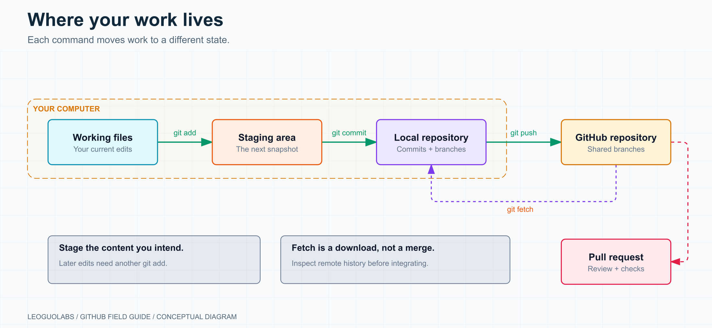
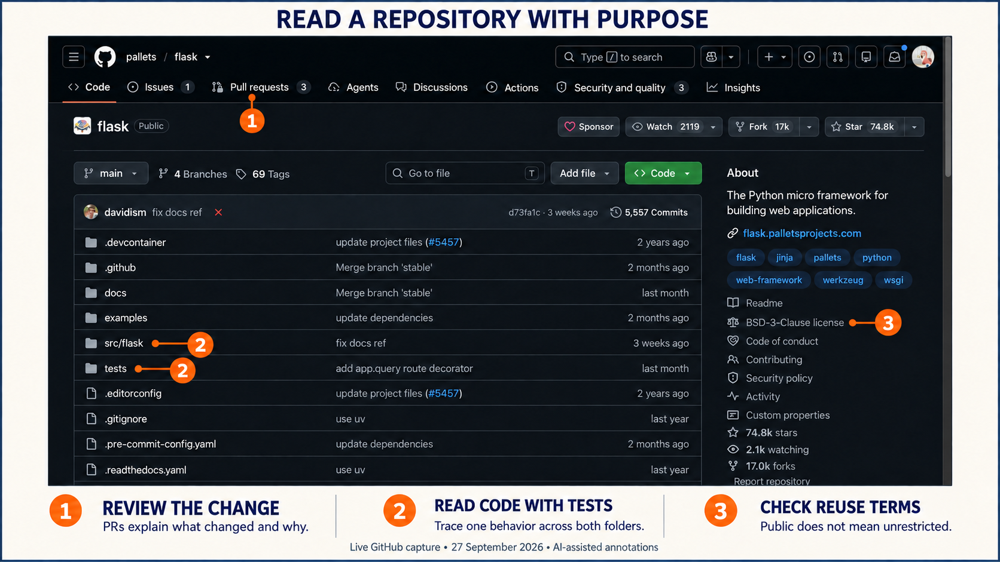
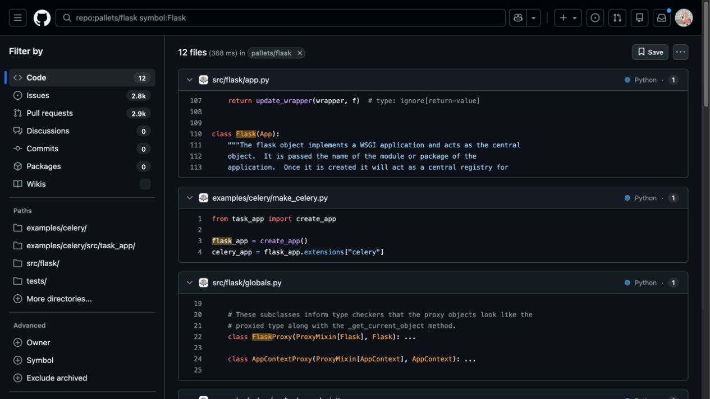
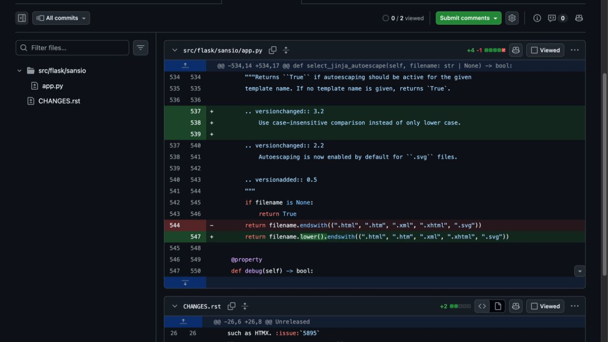
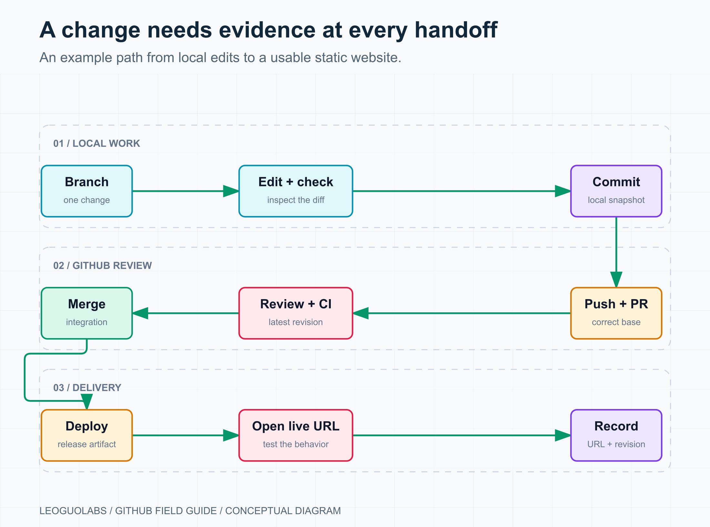
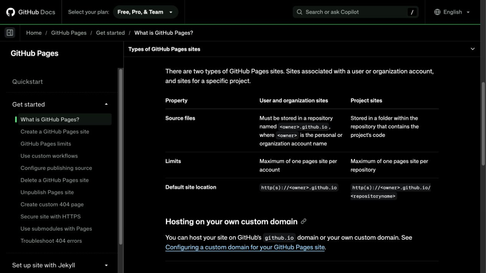

# GitHub: From First Commit to Verified Delivery

**A practical field guide to understanding projects, making reviewable changes, and checking what actually shipped.**

*An original conceptual illustration. The browser captures later in this guide show real GitHub pages.*

GitHub becomes useful when you can answer a few concrete questions: Where does this project live? What changed? Why did it change? Has anyone checked it? Is the result available to the person who needs it?

That is how I would approach learning it. Start with one small project and take one change through the whole process. The commands matter, but they make more sense when each one moves work to a clearly understood state.

AI can handle much of the typing. You still need to recognize the difference between a file being edited, a commit being created, a branch being pushed, a pull request being merged, and a website actually working. That distinction is useful whether you write every line yourself or delegate most of the implementation.

## 1. Know where your work lives

Git is a distributed version-control system. It records snapshots and their relationships, letting you inspect history, compare versions, and develop changes on branches. GitHub hosts Git repositories and adds collaboration tools such as issues, pull requests, reviews, and automation.

You can create commits and inspect existing history without an internet connection. Sharing with a remote server needs a connection to that server. GitHub's web editor and GitHub Desktop are also valid ways to work; learning the command line helps you understand what those interfaces do. [Git's introduction](https://git-scm.com/book/en/v2/Getting-Started-What-is-Git%3F) explains the snapshot model.

Six terms cover most of the early confusion:

| Term | What it means in practice |
|---|---|
| Repository | The project's versioned history and references. A normal local checkout also has working files. |
| Working tree | The files you are editing right now. Some edits may not be committed. |
| Staging area, or index | The exact content selected for the next commit. |
| Commit | A recorded snapshot with metadata and links to its parent history. |
| Branch | A movable reference to a commit. New commits advance the current branch. |
| Remote | A named connection to another repository. `origin` is a convention, not a special server. |

Staging deserves one extra moment of attention. If you run `git add` and then edit the file again, the staged version still contains the earlier content. Stage it again to include the new edits, or deliberately leave them for a later commit. `git diff` and `git diff --staged` show those two different comparisons.

*Editing, staging, committing, and pushing each do a different job. Fetch downloads remote history without merging your current branch.*

Here is a useful practical distinction. **Clone** creates a local repository and working copy. **Fork** creates a related repository under another GitHub owner. **Download ZIP** gives you files at a particular revision without the Git history needed for the usual collaboration workflow.

A branch is lightweight because it is a reference, but switching branches can change the files in your working tree. Uncommitted edits can sometimes travel with you when switching branches. Creating a branch does not automatically save them.

Version control also has a boundary: an uncommitted file is not protected merely because it sits in a Git directory. A commit stored only on a failed disk can be lost with that disk. Push important work, and maintain backups for data that does not belong in the repository.

## 2. Set up identity and access once

Install Git from a trusted source and check that your terminal can find it:

~~~bash
git --version
~~~

On macOS, `brew install git` is an option if you already use Homebrew. On Windows, use [Git for Windows](https://git-scm.com/downloads/win); Git Bash is convenient for the shell examples in this guide, while PowerShell also supports Git. On Linux, use your distribution's package manager. There is no need to change terminals simply to prove you are using Git correctly.

Configure the identity written into commits:

~~~bash
git config --global user.name "Your Name"
git config --global user.email "YOUR_VERIFIED_OR_NOREPLY_EMAIL"
git config --global init.defaultBranch main
~~~

Replace the placeholders first. The `--global` option applies to your user account on this computer. To use a different identity for a work repository, run the corresponding commands inside that repository without `--global`.

Your commit name does not have to equal your GitHub username. For GitHub to attribute commits to your account, use an email associated with that account, or the exact no-reply address shown in your GitHub email settings. Contribution-calendar visibility has additional conditions; a missing green square is not proof that the commit disappeared. See [commit email settings](https://docs.github.com/en/account-and-profile/how-tos/email-preferences/setting-your-commit-email-address).

For the account itself, use an email you can reliably access, configure two-factor authentication or an appropriate passkey, and store recovery methods somewhere you can reach if your usual device fails. A [username can be changed](https://docs.github.com/en/account-and-profile/concepts/username-changes), but it affects links and integrations, so choose one you can keep. Account identity and Git authentication are separate from the author metadata above.

### Choose one authentication route

For a first setup, HTTPS with GitHub CLI or Git Credential Manager is usually straightforward. With [GitHub CLI](https://cli.github.com/) installed:

~~~bash
gh auth login
gh auth status
~~~

Choose GitHub.com, HTTPS, and browser sign-in, and follow the prompt to authenticate Git when offered. [GitHub's credential guide](https://docs.github.com/en/get-started/git-basics/caching-your-github-credentials-in-git) documents this route and the Git Credential Manager alternative. Your GitHub account password is not the password for HTTPS Git operations.

SSH is another good option, especially if you already understand key pairs:

~~~bash
ssh-keygen -t ed25519 -C "you@example.com"
~~~

Check for an existing key before generating one, avoid overwriting it, and use a passphrase. Add the **public** key, the file ending in `.pub`, to GitHub's SSH settings. Keep the private key on your machine and follow the operating-system-specific agent setup. GitHub's [SSH guide](https://docs.github.com/en/authentication/connecting-to-github-with-ssh/generating-a-new-ssh-key-and-adding-it-to-the-ssh-agent) uses Ed25519, with an RSA alternative for older systems.

~~~bash
ssh -T git@github.com
~~~

At the first connection, compare the host fingerprint with [GitHub's published fingerprints](https://docs.github.com/en/authentication/keeping-your-account-and-data-secure/githubs-ssh-key-fingerprints). A successful authentication message also says GitHub does not provide shell access; that is expected. Then use the SSH repository URL, such as `git@github.com:YOUR-USERNAME/field-notes.git`.

Personal access tokens are useful when an integration requires one. Prefer a fine-grained token when it supports the task, restrict repository access and permissions, and set an appropriate expiry. Do not put a token into a remote URL, README, screenshot, or shell example. For automation, GitHub Apps and the workflow's built-in `GITHUB_TOKEN` may fit better than a personal token. [GitHub's authentication documentation](https://docs.github.com/en/authentication/keeping-your-account-and-data-secure/about-authentication-to-github) explains these distinctions.

## 3. Read a repository before installing it

When I evaluate a project, I want to know what I would be taking responsibility for. A polished landing page is useful, but the repository often reveals the practical cost of adopting the software.

Start with five questions:

1. **What problem does it solve?** Read the README and a small example.
2. **What does it need to run?** Check supported runtimes, dependencies, services, and configuration.
3. **What may I do with it?** Read the license before reuse or redistribution.
4. **How does it change?** Look at releases, the changelog, recent meaningful commits, and merged PRs.
5. **How would I get help or contribute?** Read contribution instructions, issue templates, and the security policy.

*A fresh capture of the public Flask repository, with AI-assisted teaching annotations. [Open the unedited capture](screenshots/originals/01-repository.png) for exact interface details.*

The main controls have different purposes. **Star** saves a project for later and signals interest. **Watch** controls notifications. **Fork** creates your own related repository. **Issues** organize reports and work proposals. **Pull requests** present proposed changes and the discussion around them.

I would not rank these signals equally. A large star count tells you that a project attracted attention. It does not establish security, maintenance quality, compatibility with your environment, or suitability for production. A recent push can be an automated dependency update. An older release can belong to stable software that needs little change.

Look for evidence relevant to your use case. If you need a particular database version, search the documentation and issues for that version. If you need predictable upgrades, inspect a recent release and its migration notes. If you need maintainers to accept a new integration, read the contribution policy before writing it.

A public repository is also not automatically permission to reuse everything in it. Check the license and included dependencies. The absence of a license is something to resolve before building a reuse plan around the code. GitHub explains this in [Licensing a repository](https://docs.github.com/en/repositories/managing-your-repositorys-settings-and-features/customizing-your-repository/licensing-a-repository).

## 4. Search for a question, not just a keyword

GitHub has several search surfaces. Repository search, issue search, and code search answer different questions and do not share every qualifier.

For repository discovery, try:

~~~text
topic:self-hosted language:Go archived:false pushed:>=2026-01-01
~~~

This narrows the list to a topic, language, archive state, and recent push activity. Adjust the date as time passes. Treat it as a shortlist, then inspect the projects. The filter does not certify maintenance. [Repository search syntax](https://docs.github.com/en/search-github/searching-on-github/searching-for-repositories) also supports qualifiers such as `in:readme`, `org:`, and `license:`.

For an issue you might help with, use the Issues search surface:

~~~text
repo:pallets/flask is:issue is:open label:"good first issue"
~~~

Zero results is a valid result. A beginner label is an invitation to investigate, not a promise that the task is available or simple. Check whether somebody is already working on it and whether the project currently accepts contributions.

For code, ask a narrower question:

~~~text
repo:pallets/flask symbol:Flask
repo:pallets/flask path:tests "test_client"
~~~

The first query searches symbol definitions; the second restricts a text search to test paths. A bare word can match a path as well as file contents. Code search has its own syntax, and symbol search is not a list of every runtime call site. See [GitHub Code Search](https://docs.github.com/en/search-github/github-code-search/understanding-github-code-search-syntax).

*The query constrains the repository and the kind of result. Search results are starting points; open the file to understand its context.*

An `awesome` list or a topic page can be useful for discovery, but follow the link to the actual project before deciding. Lists can outlive the software they recommend.

## 5. Follow one behavior through the code

Reading an unfamiliar project in directory order is easy to start and difficult to finish. I would begin with a behavior small enough to explain in one paragraph.

For a web application, that might be: “A request reaches this route, the handler reads a value, and the response contains a result.” For a command-line tool: “This option is parsed, passed into a function, and changes the output.” For a library: “This public function accepts these inputs and raises this error under these conditions.”

Use a short investigation loop:

| Step | What to look for | What to write down |
|---|---|---|
| Read the smallest example | Inputs, expected output, required services | One behavior to trace |
| Find the entry point | CLI script, application factory, route, exported function | The first relevant file and symbol |
| Follow the calls | Validation, transformations, I/O boundaries | A short path through the code |
| Read the matching tests | Normal cases, invalid inputs, regressions | What behavior is actually asserted |
| Inspect history | Commit messages, related PRs, review discussion | Why a surprising decision exists |

The Flask repository makes this approach visible: `src/flask`, `tests`, `examples`, and `docs` have different jobs. Its entry points depend on whether you are studying the CLI, an application, or the library itself. There is no universal “first file” that explains every project.

Run the smallest relevant example or test once you understand its requirements. For an unfamiliar repository, first read the install scripts and configuration rather than handing it credentials or connecting it to important services. A controlled local run can confirm a hypothesis that static reading leaves uncertain.

History often adds the missing context:

~~~bash
git log --oneline -- path/to/file
git blame path/to/file
git show COMMIT_ID -- path/to/file
~~~

Replace the file and commit placeholders. Blame points to the last relevant change for a line; the associated commit or PR may explain the reason. It is a lead for investigation, not a complete account of authorship.

On GitHub, `t` opens the file finder, `.` opens the github.dev editor, and `y` turns a supported file URL into a commit-specific permalink. The web editor is useful for reading and editing, but it does not provide the compute environment of Codespaces. [GitHub's keyboard shortcuts](https://docs.github.com/en/get-started/accessibility/keyboard-shortcuts) and [github.dev documentation](https://docs.github.com/en/codespaces/the-githubdev-web-based-editor) describe the available behavior.

AI can help map the path. A useful request is: “Explain how this input reaches this output. Cite file paths and symbols. Separate what you inspected from what you inferred, and identify the smallest test that could check the explanation.” Read the cited code before relying on the answer.

## 6. Make your first change in a small project

The companion folder contains a small project called **field-notes**: two HTML pages, a README, an ignore file, a local link checker, and an Actions workflow. It uses Python's standard library for the check, with no third-party packages to install.

Copy `companion/field-notes` somewhere you use for experiments. Start in that copied directory, which should not already be inside another Git repository.

~~~text
field-notes/
├── README.md
├── .gitignore
├── docs/
│   ├── index.html
│   └── checklist.html
├── tools/
│   └── check_site.py
└── .github/
    └── workflows/
        └── check.yml
~~~

The aim is deliberately modest: version a working site, improve one checklist, review the change, and eventually publish the static files.

### Record a known starting point

~~~bash
cd field-notes
git init -b main
git status
git add README.md .gitignore docs/index.html docs/checklist.html
git add tools/check_site.py .github/workflows/check.yml
git diff --staged
git commit -m "Add field notes site and local link check"
git log --oneline -3
~~~

Check the diff before committing. It should contain the intended project files, with no credentials or unrelated documents. The first commit records the starting point on your computer.

The sample ignore file excludes local secrets and generated clutter:

~~~gitignore
.env
.env.*
!.env.example
.venv/
__pycache__/
.DS_Store
*.log
~~~

Keep `.env.example` limited to placeholder values. Adding a file to `.gitignore` does not untrack a file that Git already tracks, and it does not remove an old secret from history.

### Put one improvement on a branch

~~~bash
git switch -c docs/add-release-check
~~~

Open `docs/checklist.html` in an editor. Add a new checklist item reminding the reader to open the deployed URL and check its links. Then inspect and validate the change:

~~~bash
git diff
python3 tools/check_site.py
git add docs/checklist.html
git diff --staged
git commit -m "Add a live-site check to the release checklist"
git status --short --branch
~~~

On Windows, use `py` or `python` instead of `python3` if that is how Python is installed. The checker detects missing local HTML link targets and basic page-structure problems. It does not test external sites, JavaScript behavior, accessibility, or production hosting.

To view the site locally:

~~~bash
python3 -m http.server 8000 --bind 127.0.0.1 --directory docs
~~~

Open `http://127.0.0.1:8000/`, follow the checklist link, and confirm the new item appears. Stop the server with Ctrl+C when finished.

There are now two kinds of evidence: a recorded diff and an observed local page. Neither tells you that anything has reached GitHub yet.

## 7. Push to GitHub and open a reviewable PR

Create a repository named `field-notes` under your own account. Choose the visibility you intend. Because the local repository already contains its initial files and history, leave GitHub's README, license, and ignore-file initialization options off for this exercise.

Use the exact repository URL shown by GitHub, replacing the username below. This example uses HTTPS:

~~~bash
git remote add origin https://github.com/YOUR-USERNAME/field-notes.git
git remote -v
git switch main
git push -u origin main
git switch docs/add-release-check
git push -u origin docs/add-release-check
~~~

The two pushes serve different purposes. The first establishes the base branch. The second publishes the proposed change. `-u` records the upstream relationship for subsequent operations on that local branch.

Open the repository on GitHub, select the correct branch, and compare the latest commit with:

~~~bash
git rev-parse HEAD
~~~

Then create a pull request from `docs/add-release-check` into `main`. Inspect the **base repository**, **base branch**, **head branch**, and **Files changed** before submitting.

A useful description for this exercise is short:

~~~text
The release checklist ended after the build step.
This change adds a check of the deployed URL and its links.

Validation:
- The local link checker passed.
- The checklist page displayed the new item in the local browser.

Public deployment has not been verified yet.
~~~

Use those validation statements only after doing the checks. A reviewer should be able to tell what changed, why it matters, and what evidence is available.

If review reveals a problem, update the same branch, commit the fix, and push again. The PR updates with that branch. Recheck the latest revision instead of relying on results from an earlier commit.

### Contributing to somebody else's project

First read its contribution policy and confirm the proposed work is welcome. Some repositories restrict PR creation or direct contributions elsewhere. Reading their existing PRs remains useful even when they are not accepting yours.

When a fork is appropriate, the common arrangement is:

~~~text
origin    → your fork
upstream  → the original repository
~~~

Clone your fork, add the original repository as `upstream`, and start a contribution branch from the current upstream base:

~~~bash
git clone https://github.com/YOUR-USERNAME/PROJECT.git
cd PROJECT
git remote add upstream https://github.com/ORIGINAL-OWNER/PROJECT.git
git fetch upstream
git switch -c docs/fix-example upstream/main
~~~

These are placeholders; the project may use a different default branch. After changing and checking the intended files, commit them and push your branch to `origin`. The PR usually targets the original repository's base branch.

Keep the fork's `main` free of your feature commits if you want a simple synchronization routine:

~~~bash
git switch main
git fetch upstream
git merge --ff-only upstream/main
git push origin main
~~~

The fast-forward option stops if the histories diverge. Inspect that situation before deciding how to integrate it. A refusal is useful information, not a reason to force-push. [GitHub's fork synchronization guide](https://docs.github.com/en/pull-requests/how-tos/work-with-forks/syncing-a-fork) covers the broader workflow.

## 8. Learn to read a diff and resolve a disagreement

A small PR is an efficient unit of learning. It shows a problem, a proposed solution, the affected tests, and the decisions made during review.

*A real merged PR used as a reading example. Its merged status records integration into the project; it does not demonstrate that your application has deployed that change.*

In this [Flask change](https://github.com/pallets/flask/pull/6013/changes), the relevant line adds `filename.lower()` before checking the template extension. That gives you a concrete question: should `page.HTML` now receive the same autoescaping treatment as `page.html`? The diff also changes the changelog and function documentation. It does not add a test file. You can understand the intended behavior while still asking what test coverage establishes it.

Review in three passes. First, check scope: are all changed files relevant? Next, inspect behavior: what inputs or conditions produce different results? Finally, inspect evidence: which test would have failed before the change and passes afterward? For a documentation change, this may be a corrected command or link that you can follow directly.

Merge conflicts are another form of disagreement. Git found edits it could not combine automatically. The task is to decide the correct resulting content.

With your current work committed and the working tree clean, you can bring the current base into your feature branch:

~~~bash
git fetch origin
git merge origin/main
~~~

If Git reports conflicts, run `git status`, open the named files, and inspect both sides of the conflict markers. Write the intended result, remove the markers, and validate the behavior. Then stage only the resolved files and finish the merge commit.

~~~bash
git add path/to/resolved-file
git commit
~~~

If you need to stop the merge, `git merge --abort` attempts to restore the pre-merge state. Starting from a clean working tree makes this easier to reason about. Do not resolve a conflict by mechanically keeping every line from “ours” or “theirs”; either choice can discard necessary work.

Rebase is useful when the team wants a linear history, but it rewrites commit identities. Learn it after you can inspect the graph and recover a mistake. Follow the project's policy before rewriting a branch that other people use.

## 9. Automate a check you already understand

GitHub Actions runs workflows defined under `.github/workflows/`. A workflow specifies an event, one or more jobs, their runners, and the steps each job executes.

The companion's `check.yml` runs the same local site check used earlier:

~~~yaml
name: Check site

on:
  push:
    branches: [main]
  pull_request:

permissions:
  contents: read

jobs:
  check:
    runs-on: ubuntu-latest
    timeout-minutes: 5
    steps:
      - uses: actions/checkout@v7
        with:
          persist-credentials: false
      - uses: actions/setup-python@v7
        with:
          python-version: '3.13'
      - name: Check local pages and links
        run: python tools/check_site.py
~~~

The major versions above match the official [checkout](https://github.com/actions/checkout) and [setup-python](https://github.com/actions/setup-python) examples checked for this edition. For a production workflow, consider pinning actions to reviewed full commit SHAs and maintaining those pins. Do not paste a random SHA from a tutorial and assume it is current.

This workflow requests read access and does not need secrets. It checks pushes to `main` and pull requests; it does not run on every push to every feature branch before a PR exists.

To learn what a failure means, change the sample site's checklist link to a nonexistent file in your practice branch. Run the checker locally and observe the failure. Restore the correct path and confirm it passes. If you later push that experiment, the Actions job should exercise the same condition. The local exercise and the hosted run are separate checks.

When a workflow fails, open the run, then the failing job and step. Read the first useful error above the final exit-code summary. A missing file, incorrect working directory, unavailable dependency, and authentication failure require different fixes.

A passing workflow only establishes what its steps checked. A link check does not establish visual quality. A test suite does not automatically establish deployment. A deployment job does not automatically establish that a customer can use the feature.

*Record the evidence at each handoff. If the PR changes, evaluate the new revision.*

### Understand the limits before adding more automation

GitHub Free currently includes 2,000 monthly Actions minutes for applicable private-repository use. Standard GitHub-hosted runners for public repositories are free to use; larger runners have separate billing. Artifacts and caches also have storage rules. Operating systems and machine sizes can have different rates, so use the current billing page rather than memorizing an old multiplier table. [GitHub Actions billing](https://docs.github.com/en/billing/concepts/product-billing/github-actions) is the reference to check.

Use timeouts and sensible concurrency. Review the account's budgets, alerts, and whether a budget actually stops usage. These are ordinary operating controls for a service that can run repeatedly without somebody watching each invocation.

## 10. Put a static site online with Pages

GitHub Pages hosts static HTML, CSS, and JavaScript. It can publish files directly or publish the output of a build. It does not give your site a continuously running Python, Node, or PHP backend. A browser-based app can call a separate backend, but that backend must be hosted elsewhere.

Two common URL patterns are:

| Site | Repository | Default URL |
|---|---|---|
| Personal or organization site | `OWNER.github.io` | `https://OWNER.github.io/` |
| Project site | A repository such as `field-notes` | `https://OWNER.github.io/field-notes/` |

GitHub Free supports Pages in public repositories. Other plans add options for private repositories, but private source-code visibility should not be confused with private website access. See [What is GitHub Pages?](https://docs.github.com/en/pages/getting-started-with-github-pages/what-is-github-pages) and the plan details before publishing restricted material.

For the companion site, after merging the checklist PR:

1. Open the repository's **Settings → Pages**.
2. Under **Build and deployment**, choose **Deploy from a branch**.
3. Select `main` and the `/docs` folder, then save.
4. Inspect the deployment run and open the URL GitHub provides.

These steps follow the current [publishing-source documentation](https://docs.github.com/en/pages/getting-started-with-github-pages/configuring-a-publishing-source-for-your-github-pages-site). If your project needs a custom build pipeline, use the supported Actions publishing route instead.

*A new capture of the official documentation. Pages settings and deployment results belong to your own repository and must be verified there.*

Project sites have a practical path trap. A link to `/checklist.html` points at the domain root, while `checklist.html` resolves next to the current page. In this simple two-page site, relative links work both at localhost and beneath `/field-notes/`. Frameworks often have their own base-path setting.

After deployment, open the public URL in the browser. Follow internal links, inspect images and styling, and check the updated content. For a static release, compare the deployed result with the intended revision instead of stopping at a green build badge.

All files sent to a visitor's browser should be treated as public. A secret embedded in client-side JavaScript is still exposed even if it came from a build-time environment variable.

## 11. Use the free tier with the right expectations

The free tier is useful for learning and small projects, provided you understand what each service supplies.

| Service | Practical use | Boundary to remember |
|---|---|---|
| Repositories | Store and collaborate on versioned work | Free personal accounts support unlimited public/private repositories and collaborators; private-repository features are more limited. |
| Actions | Run checks, builds, and deployment tasks | Runner type, repository visibility, storage, and plan affect usage and cost. |
| Pages | Publish documentation, a portfolio, or a static demo | Static hosting; no application server process. |
| github.dev | Read and edit a repository in a browser | An editor, without a Codespaces compute environment. |
| Codespaces | Work in a cloud development environment | Compute and storage are separate metered resources. |

For personal GitHub Free accounts, Codespaces currently includes **120 core-hours** of compute and **15 GB-month** of storage. A 2-core machine therefore uses two core-hours per running hour: the compute allowance corresponds to about 60 running hours at that size. A 4-core machine uses it in about 30 hours. These are allowance calculations, not promises about uptime or workload performance.

Stopping a codespace stops active compute usage; its stored files still consume storage while it exists. Commit and push work you want to keep before deleting an unused environment. Treat Codespaces as a development workspace when planning your usage. [Codespaces billing](https://docs.github.com/en/billing/concepts/product-billing/github-codespaces) and [GitHub's plans](https://docs.github.com/en/get-started/learning-about-github/githubs-plans) contain the current allowances.

AI assistant allowances change separately. Check the current Copilot plan if that matters to your workflow rather than bundling an old completion quota into a Git tutorial.

*Plan and platform details in this edition were checked on 27 September 2026. The linked official pages are the place to recheck them.*

## 12. Recover from mistakes by identifying what changed

When something goes wrong, first locate it: working files, staging, local history, remote history, or the deployed system. “Undo” means different things at each layer.

### You staged the wrong file

~~~bash
git restore --staged path/to/file
~~~

This removes the change from the next commit's staging area while leaving the working file in place. Review `git status` and the staged diff again. The normal example assumes the repository already has a commit. [Git restore](https://git-scm.com/docs/git-restore) documents the source and destination options.

### You need to pause unfinished work

~~~bash
git stash push -u -m "Pause checklist edits"
git stash list
~~~

The `-u` option includes untracked files, but not ignored files. A stash is local storage, not an off-machine backup. When ready, `git stash apply` restores the changes while keeping the stash entry; inspect the result before deciding to drop the saved entry.

For work that deserves a durable checkpoint, a temporary branch and a clearly described commit can be easier to inspect.

### A committed change needs reversing

For a normal published commit, consider:

~~~bash
git revert COMMIT_ID
~~~

Revert creates a new commit that reverses a previous change, preserving the existing history. Replace the placeholder, inspect the result, and validate it. Merge commits need additional care and a mainline choice. [Git revert](https://git-scm.com/docs/git-revert) explains the details.

Commands such as `git reset --hard` and `git restore path/to/file` can discard local content. Establish what you need to preserve before using them. A convenient command copied from a troubleshooting answer may target a different layer from your actual problem.

### A push is rejected

Check `git remote -v`, your current branch, and the actual error. Authentication failure, a protected branch, and a non-fast-forward rejection are different conditions.

For a history disagreement, fetch first and inspect:

~~~bash
git fetch origin
git log --oneline --graph --decorate --all -15
~~~

Decide how to integrate the other work. Do not treat force-push as a universal repair button.

### A credential reached a commit

Revoke or rotate the credential first. Then investigate exposure and decide what history cleanup and coordination are needed. Deleting the current file does not remove older copies, forks, logs, or caches. GitHub's [leaked-secret guidance](https://docs.github.com/en/code-security/tutorials/remediate-leaked-secrets/remediating-a-leaked-secret) gives the remediation sequence.

### A large file is rejected

GitHub blocks regular Git files larger than **100 MiB**; browser uploads have a lower limit. Consider Git LFS for appropriate large versioned assets, release assets for distributable binaries, or object storage for datasets and recordings. LFS has its own storage and bandwidth considerations. Adding an LFS rule later does not automatically rewrite an oversized file out of earlier commits. See [GitHub's large-file documentation](https://docs.github.com/en/repositories/working-with-files/managing-large-files/about-large-files-on-github).

### A repository or fork suddenly returns 404

Check the URL, current account, and access rights. The project may have moved, changed visibility, or changed its fork relationships. A local clone does not grant access to a repository you can no longer read. Verify the upstream address and permissions before editing remotes or creating another fork.

## 13. Keep collaboration simple enough to follow

For many small teams, a useful starting point is a releasable `main` branch plus short-lived task branches. Open a PR, review it, run relevant checks, merge, and verify the delivered behavior. This follows the shape of [GitHub flow](https://docs.github.com/en/get-started/using-github/github-flow).

A permanent `dev` branch can make sense when the release process requires a separate integration stage. Add it for that reason. Every long-lived branch creates another place where work can diverge and another transition somebody has to manage.

Where your plan and repository support it, use branch protection or [rulesets](https://docs.github.com/en/repositories/configuring-branches-and-merges-in-your-repository/managing-rulesets/about-rulesets) to require the checks and reviews your team actually needs, and restrict force-pushes and deletion of important branches. Check that the rule targets the intended branch and is actively enforced. Do not require a second person's approval in a solo workflow without understanding how you will complete it.

The same clarity helps your profile. A public repository matching your GitHub username can display its root README on your profile. Describe what you are building, link to a few useful projects, and state the limits of demonstrations honestly. A reproducible README and a working example tell a reader more than a wall of badges. See [Managing your profile README](https://docs.github.com/en/account-and-profile/how-tos/profile-customization/managing-your-profile-readme).

If you encounter other names, separate tools from hosting platforms:

| Name | Role |
|---|---|
| Git | A distributed version-control system |
| [Subversion, or SVN](https://subversion.apache.org/) | A different version-control system, built around a centralized repository model |
| GitHub | A platform for hosting Git repositories and collaborating around them |
| [GitLab](https://docs.gitlab.com/user/project/repository/) | A development platform with Git hosting and integrated delivery tooling |
| [Gitee](https://gitee.com/) | A Git hosting and collaboration platform |

Git knowledge transfers across Git hosts. Their permissions, automation, hosting options, and interfaces still differ. Learn the platform your project uses rather than assuming every feature maps one-to-one.

## 14. Give AI a clear task and a clear stopping point

An agent can inspect a repository, create a branch, make changes, run checks, and prepare a PR when its tools and permissions allow it. The useful skill is specifying the result and reviewing the evidence.

For example:

~~~text
Inspect this repository and its contribution instructions.
Add a live-URL verification step to the release checklist.

Keep the change limited to the relevant documentation.
Preserve existing unrelated edits.
Show the diff and run the checks appropriate to this change.

Report the branch, changed files, checks actually run, and any
remaining uncertainty. Prepare a PR description.
Stop before pushing, merging, or changing repository settings.
~~~

Adjust that stopping point to the authority you intend to give. If you want the agent to push a branch or create a PR, say so explicitly and specify the destination.

Then inspect the work at the same boundaries you would use for a human contribution. Did it edit the intended files? Is the commit on the intended branch? Does the remote point to the intended repository? Did the checks run on the final revision? If it says “deployed,” which URL was opened, and what behavior was observed there?

Those questions are a compact way to stay responsible for work you did not type yourself.

## 15. Keep a small command card beside the project

| Intent | Command |
|---|---|
| See the current state | `git status --short --branch` |
| Inspect unstaged tracked changes | `git diff` |
| Inspect the next commit | `git diff --staged` |
| Stage one file | `git add path/to/file` |
| Create a branch | `git switch -c task/name` |
| Record staged work | `git commit -m "Explain the change"` |
| Inspect recent history | `git log --oneline --graph --decorate -10` |
| Check remote destinations | `git remote -v` |
| Download remote history | `git fetch origin` |
| Publish the current branch explicitly | `git push -u origin task/name` |
| Unstage while keeping edits | `git restore --staged path/to/file` |
| Reverse an ordinary committed change | `git revert COMMIT_ID` |

`git diff` does not show the contents of untracked files; `git status` tells you they exist. Replace all placeholder paths, branch names, and commit IDs before running a command.

My preferred first milestone is one small change that another person can inspect, reproduce, and use. Read enough of the project to understand that change. Record it clearly. Let the checks challenge it. Open the delivered result.

Once you can follow that path, the next GitHub feature usually has somewhere obvious to fit.
